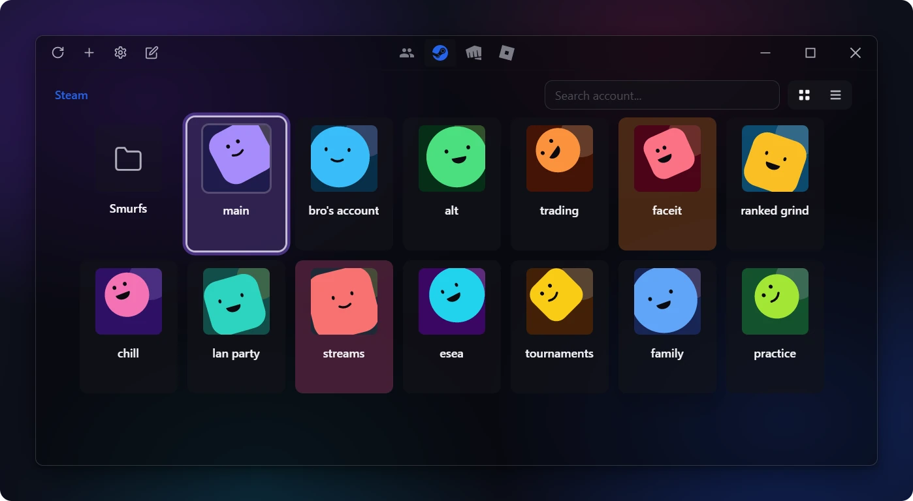

<p align="center">
  
</p>
<h1 align="center">accshift</h1>
<p align="center">
  <a href="#download">Download</a> ·
  <a href="https://github.com/klNuno/accshift/wiki">User guide</a> ·
  <a href="docs/README.md">Documentation</a>
</p>

accshift switches game accounts in one click. Pick an account and the launcher
restarts already signed in. It never asks for your password: it saves the
session the launcher already keeps, and encrypts it on your machine. Free and
open source for Windows, macOS and Linux.

<p align="center">
  
</p>

## Download

Click the file for your computer. Updates then install from inside the app.

| Your computer | Download |
| --- | --- |
| Windows (x64) | [Installer (.exe)](https://github.com/klNuno/accshift/releases/latest/download/accshift-windows-x64-setup.exe) |
| Mac with Apple Silicon (M1 or later) | [Disk image (.dmg)](https://github.com/klNuno/accshift/releases/latest/download/accshift-macos-arm64.dmg) |
| Linux (x64) | [Debian / Ubuntu (.deb)](https://github.com/klNuno/accshift/releases/latest/download/accshift-linux-amd64.deb) · [Fedora / openSUSE (.rpm)](https://github.com/klNuno/accshift/releases/latest/download/accshift-linux-x86_64.rpm) · [AppImage](https://github.com/klNuno/accshift/releases/latest/download/accshift-linux-x86_64.AppImage) |
| Stream Deck (Windows) | [Plugin (.streamDeckPlugin)](https://github.com/klNuno/accshift/releases/latest/download/accshift-streamdeck.streamDeckPlugin) |

- **Windows**: run the installer. Windows may show "Windows protected your
  PC" because the app is not signed yet: click **More info**, then **Run
  anyway**. With winget: `winget install klNuno.Accshift`.
- **Mac**: open the disk image and drag Accshift to Applications. The app is
  not notarized yet, so run `xattr -cr /Applications/Accshift.app` once in
  Terminal before the first launch.
- **Linux**: open the `.deb` or `.rpm` with your software center. For the
  AppImage, allow it to run as a program (`chmod +x`), then open it.

The command-line tool, checksums and older versions are on the
[releases page](https://github.com/klNuno/accshift/releases).

## Supported platforms

| Platform        | Windows | macOS | Linux |
| --------------- | :-----: | :---: | :---: |
| Steam           |   ✅    |  ✅   |  ✅   |
| Riot Games      |   ✅    |       |       |
| Battle.net      |   ✅    |  ✅   |       |
| Epic Games      |   ✅    |       |       |
| Ubisoft Connect |   ✅    |       |       |
| Roblox          |   ✅    |       |       |
| GOG Galaxy      |  Beta   |       |       |
| Jagex Launcher  |  Beta   |       |       |
| Discord         |  Beta   |       |       |

Beta means built and working, but too few users have reported back to call it
stable. [Open an issue](https://github.com/klNuno/accshift/issues/new/choose)
for a bug or a missing platform. Most platforms are a JSON descriptor, so you
can add a launcher without compiling anything
([docs/platform-descriptors.md](./docs/platform-descriptors.md)).

## Features

- Switch from the grid, or from the `Ctrl+K` (`Cmd+K` on macOS) command palette.
- Personas group one account per platform and switch them all at once.
- Folders, search, drag and drop, card colors and private notes for large
  libraries.
- Light, Dark, Midnight, acrylic and Liquid Glass themes, all editable files
  ([docs/theming.md](./docs/theming.md)).
- Steam: copy game settings between accounts, bulk edit launch options, ban
  tracking, online or invisible switch, switch and launch a game.
- Streamer mode blurs names and avatars while OBS or another streaming app
  runs.
- Global shortcuts, a PIN lock, a [CLI](./docs/cli.md), `accshift://` deep
  links and a [Stream Deck plugin](integrations/streamdeck/README.md).
- 7 languages: English, Spanish, French, Portuguese, Brazilian Portuguese,
  Russian and Simplified Chinese.

## Privacy

- **No passwords.** accshift saves the session state needed to restore an
  account, session cookies included where required, and nothing else.
- **Encrypted at rest** with what the OS provides: DPAPI on Windows, Secret
  Service on Linux, Keychain on macOS. The threat model and what the PIN lock
  covers are in the [security policy](./.github/SECURITY.md).
- **Telemetry is anonymous counters, opt-out, plus an enhanced tier you opt
  into.** Both are switches in Settings, Privacy. Nothing is sent before you
  answer the first-launch screen, and no feature depends on it.

<details>
<summary>What is sent, and what never is</summary>

<br />

Never sent, in any mode: account names, platform identifiers such as SteamID,
passwords, tokens, cookies, persona or folder names, file paths and log files.
An event can say "an account was added on Steam"; it cannot say which account.
Your IP address reaches the server like any request does; the server derives a
country code from it and never stores the address.

[docs/analytics.md](./docs/analytics.md) lists every event and field, shows a
real payload, says where the data is stored and how to export or delete it. The
client is in
[`crates/accshift-core/src/telemetry/`](./crates/accshift-core/src/telemetry)
and the server in [`server/`](./server).

</details>

## Development

The app is Rust, drawn with egui. Install stable Rust, then:

```bash
cargo run -p accshift-egui                                            # run the app
pnpm install && node crates/accshift-egui/bundle/bundle.mjs --build   # installers for your OS
```

The [contributing guide](./.github/CONTRIBUTING.md) covers setup, checks and
how to propose a platform; [docs/](./docs/README.md) holds the technical
references.

<details>
<summary>Project structure</summary>

```text
crates/
  accshift-core/    # platform logic, config, storage, per-OS primitives
  accshift-cli/     # the accshift command (list, switch, platforms)
  accshift-app/     # UI-free app logic: backend, stores, i18n, updater
  accshift-theme/   # theme engine: tokens, CSS variables
  accshift-egui/    # the GUI (accshift-gui) and its installer config
integrations/
  streamdeck/       # the Stream Deck plugin
server/             # the telemetry worker
```

</details>

## License

[MIT](LICENSE). Not affiliated with Valve, Blizzard, Riot Games, Epic Games,
Ubisoft, Roblox Corporation, CD PROJEKT, Jagex or Discord. Use at your own risk.
